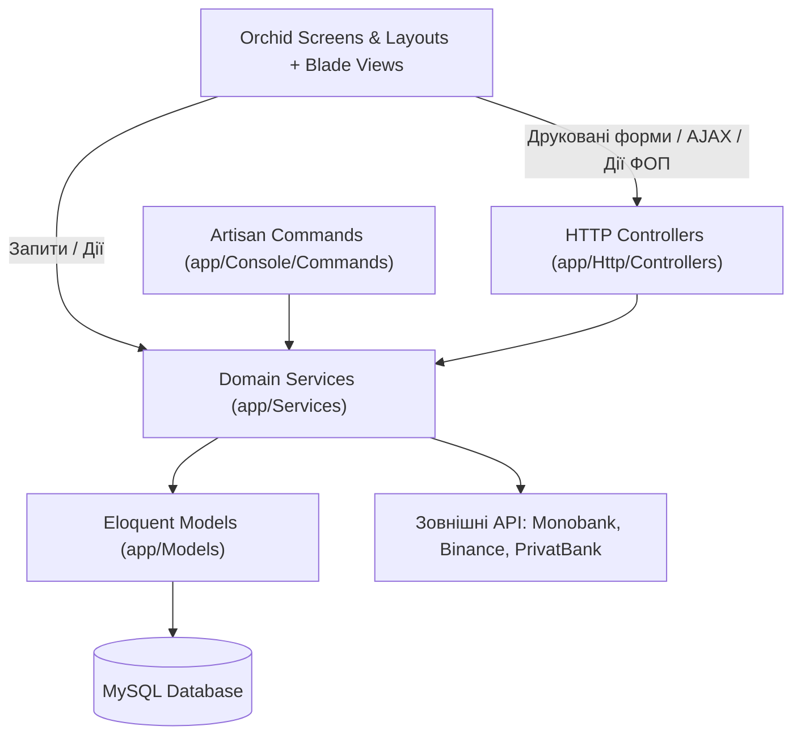
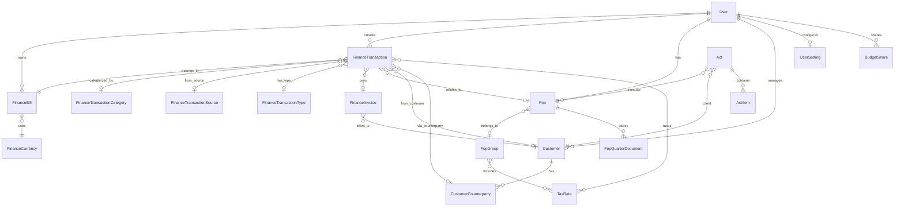

# Технічна документація проєкту Budget Boss

> [!NOTE]
> Документація сформована на основі аналізу вихідного коду, міграцій БД, маршрутів, сервісів, Orchid-екранів, Blade-шаблонів та тестів проєкту `budget-boss.loc`.

---

## 1. Загальний огляд та стек технологій

**Budget Boss** — веб-застосунок для обліку особистих і сімейних фінансів, моніторингу криптовалютного портфеля, а також комплексного ведення ФОП (облік доходів, податків, лімітів, формування актів виконаних робіт та інвойсів у PDF).

| Компонент | Технологія / Версія | Призначення |
| :--- | :--- | :--- |
| **Backend** | PHP `^8.1` (8.1.28), Laravel `^10.10` | Основний фреймворк, ORM Eloquent, роутинг, консольні команди |
| **Admin / UI Framework** | Orchid Platform `^14.23` | Екрани (`Screen`), макети (`Layout`), таблиці, форми, фільтри, права доступу, меню |
| **Графіки** | `sakanjo/laravel-easy-metrics` `^1.0`, Orchid Charts (`Chart`) + кастомний `Chartable` trait | Побудова bar/line/pie діаграм (Frappe Charts) |
| **PDF / Друк** | `barryvdh/laravel-dompdf` `^3.1` | Генерація PDF-документів (Акти наданих послуг, Рахунки на оплату, ZIP-архіви) |
| **Банкінг (Monobank)** | `guzzlehttp/guzzle` `^7.2`, власний клієнт `App\Services\Api\Monobank\Monobank` | Синхронізація виписок фізичної особи та ФОП |
| **Криптовалюта (Binance)** | `binance/binance-connector-php` `^1.6` | Отримання спотових балансів та оцінка в UAH |
| **Курси валют** | PrivatBank Public API (`pubinfo?exchange&coursid=5`) | Автоматичне оновлення курсів USD/EUR до UAH |
| **Frontend Build** | Vite `^5.0.0`, `laravel-vite-plugin` `^1.0.0`, Bootstrap 5 (через `/vendor/orchid/css/app.css`) | Базові стилі Orchid + кастомні `<style>` блоки та `resources/css/app.css` |
| **Тестування** | PHPUnit `^10.1` | Unit-тести бізнес-логіки (`tests/Unit/*`) |

---

## 2. Архітектура застосунку

Проєкт побудований за шаруватою архітектурою поверх **Laravel + Orchid Platform**:

### Ключові директорії
- `app/Models/` — 21 Eloquent-модель (фінанси, ФОП, документи, користувачі, налаштування).
- `app/Services/` — бізнес-логіка, ізольована від UI-шару (`Finance\Transaction`, `Finance\Fop`, `Finance\Analytic`, `Finance\Act`, `Finance\Bill`, `Finance\Crypto\Binance`, `Currency`, `Api\Monobank`).
- `app/Orchid/Screens/` — екрани панелі керування (Dashboard, Transactions, Bills, Invoices, Acts, FOP, Analytic, Crypto, Customers, Settings, Users/Roles).
- `app/Orchid/Layouts/` — перевикористовувані таблиці, форми, `Listener`-компоненти, графіки.
- `app/Orchid/Filters/` — фільтри Orchid (зокрема `MonthTransactionFilter`, `AccrualDateFilter`, `CreatedAtFilter` тощо).
- `app/Http/Controllers/` — `ActPrintController`, `FopTaxController`, `AnalyticCategoryTransactionsController`.
- `app/Custom/Metrics/Chartable.php` — розширення для групування транзакцій по днях і місяцях (`SumByDays`, `SumByMonths`).
- `resources/views/` — кастомні Blade-віджети для дашборду, аналітики, ФОП-кабінету та A4-шаблони друку.

---

## 3. Модель даних (Основні сутності БД)

### Ключові поля та правила транзакцій (`finance_transactions`)
- **Типи (`type`)**: `'income'` | `'expenses'`.
- **Системні типи операцій (`transaction_type_id`)**:
  - `1` — Витрата
  - `2` — Дохід
  - `3` — Переказ між власними рахунками
  - `4` — Ревізія / Початковий баланс
  - `5` — Скасування / Повернення коштів (refund)
- **Негрошові коригування (`TransactionsService::NON_FLOW_TYPE_IDS = [3, 4, 5]`)**:
  - Враховуються в реальному залишку рахунків та капіталу (`is_balance = 1`), але **виключаються** зі статистики реального доходу, витрат і місячного грошового потоку (балансу).
- **Дати транзакції**:
  - `created_at` — фактична дата проведення операції по рахунку (використовується для витрат і балансу рахунку).
  - `accrual_date` — **Дата угоди / нарахування** (використовується для обліку доходів через `COALESCE(accrual_date, created_at)`).

---

## 4. Функціональні модулі

### 4.1. Головна інформаційна панель (`DashboardScreen`, `/main`)
- **Сімейний / спільний бюджет**: перемикач учасників у командній панелі (`Всі учасники (Спільний)` або конкретний користувач), блок `dashboard.family-breakdown` з балансами та місячними показниками кожного учасника.
- **Перемикач валют**: `UAH`, `USD`, `EUR` у командній панелі з автоматичним перерахунком усіх метрик за курсом ПриватБанку.
- **Метрики**:
  - Загальний баланс (рахунки + Binance у UAH) та топ-4 рахунки.
  - Дохід і витрати за поточний місяць та поточний рік (дохід рахується за `COALESCE(accrual_date, created_at)`).
- **Віджет місячного бюджету (`dashboard.monthly-recommendations-widget`)**: планування бюджету поточного місяця на базі доходу попереднього місяця (модель 50/30/20 через `IncomeExpenseAnalysisService::monthlyBudgetFromPreviousMonth()`).
- **Моніторинг ліміту ФОП (`fop.limit-progress-widget`)**: прогрес річного ліміту доходу ФОП.
- **Графіки**:
  - `DashboardChartIncomeLayout` — порівняння доходів поточного та попереднього року по місяцях.
  - `DashboardChartCapitalLayout` — динаміка сукупного капіталу (`chartCapital`).
  - `DashboardChartTransactionLayout` — «Статистика за рік» (Дохід, Витрати, Баланс по місяцях).
- **Останні 10 транзакцій**.

### 4.2. Транзакції та категорії (`TransactionListScreen`, `TransactionEditScreen`, `Category*Screen`)
- **Створення та редагування**: окремі макети під кожен тип операції (`TransactionIncomeListener`, `TransactionEditExpensesRows`, `TransactionEditTransferRows`, `TransactionEditAuditRows`, `TransactionEditIncomeRows`).
- **Податковий розрахунок доходу (`TransactionIncomeService`)**:
  - Підтримка режимів `without_taxes`, `before_taxes`, `after_taxes`.
  - Автопідстановка рахунку, категорії, ставок податків і контрагента з налаштувань клієнта / ФОП.
  - Збереження ручної `accrual_date` навіть при прив'язці інвойсу (`finance_invoice_id`), з фолбеком на `$invoice->created_at` лише якщо `accrual_date` не вказано.
- **Фільтрація (`TransactionSelection`, `MonthTransactionFilter`)**: швидкий вибір місяця (за `COALESCE(accrual_date, created_at)`), діапазону дат, рахунку, категорії, типу.
- **Категорії та MCC**: окремі екрани для категорій доходів і витрат, зв'язок з MCC-кодами для автокатегоризації виписок Monobank.

### 4.3. Рахунки та мультивалютність (`BillScreen`, `BillEditScreen`, `Currency`)
- Керування банківськими та готівковими рахунками, прив'язка до валюти (`FinanceCurrency`) та `monobank_account_id`.
- Налаштування початкового балансу рахунку (створення аудитної транзакції з `transaction_type_id = 4`).
- Кешування курсів валют (`USD`, `EUR`) на поточну дату через `Currency::getExchangeRate()`.

### 4.4. Синхронізація з Monobank (`FopMonoSyncService`, `TransactionExpensesService`, `SyncMonoFopCommand`)
- **Особисті рахунки**: імпорт виписки, визначення MCC і джерела (`FinanceTransactionSource`), автовизначення переказів між власними рахунками (`type_id = 3`, `is_balance = 0`), розпізнавання повернень/скасувань (`type_id = 5`).
- **ФОП-рахунки**: синхронізація через `FopMonoSyncService` та Artisan-команду `SyncMonoFopCommand`, автозіставлення платежів з інвойсами за номером, визначення податкових платежів (ЄП, ВЗ, ЄСВ) і коректне виставлення `accrual_date` (наприклад, на кінець попереднього місяця).

### 4.5. Кабінет ФОП (`FopScreen`, `FopTaxScreen`, `FopLedgerScreen`, `FopAnalyticScreen`)
- **Профіль ФОП (`Fop`, `FopGroup`, `TaxRate`)**: група оподаткування, ліміт доходу, ставки ЄП/ВЗ/ЄСВ, пільга ЄСВ, банківські реквізити (IBAN, банк), договірні поля.
- **Податки та календар (`FopTaxService`, `FopTaxController`)**:
  - Розрахунок квартальних і річних податків.
  - Сплата податків, прив'язка/відв'язка наявних транзакцій до податкових зобов'язань.
  - Завантаження, зберігання та завантаження квартальних документів/декларацій (`FopQuarterDocument`).
- **Книга обліку доходів (`FopLedgerScreen`)**: перегляд, фільтрація, друк (`fop.ledger-print`) та експорт.
- **Аналітика ФОП (`FopAnalyticScreen`, `FopAnalyticService`)**: KPI за рік/квартал, динаміка доходів (`FopMonthlyRevenueChartLayout`), розбивка по клієнтах і кварталах, контроль податкової відповідності.

### 4.6. Документообіг: Акти та Інвойси (`ActListScreen`, `ActEditScreen`, `InvoiceListScreen`)
- **Клієнти та контрагенти (`CustomerListScreen`, `CustomerEditScreen`)**: підтримка кількох ФОП-контрагентів (`CustomerCounterparty`) для одного клієнта.
- **Автонумерація (`DocumentGenerationService`)**: шаблони номерів із плейсхолдерами `{PREFIX}`, `{YYYY}`, `{YY}`, `{MM}`, `{M}`, `{DD}`, `{NUM}`, `{NUM:N}`.
- **Генерація Актів і Рахунків**:
  - Створення акту напряму з транзакції доходу.
  - Пропис суми українською (`UkrainianNumberToWords`).
  - Друк A4 (`finance.act.print`, `finance.invoice.print`), завантаження PDF (`barryvdh/laravel-dompdf`), пакетне вивантаження актів у ZIP (`ActPrintController::zipActs`).
  - Масовий імпорт актів з транзакцій через команду `ImportActsFromTransactionsCommand`.

### 4.7. Фінансова аналітика та інсайти (`AnalyticFinanceScreen`)
- **Періодні KPI з трендами (`metrics.blade.php`)**: Баланс, Дохід, Витрати, Норма заощаджень, денний темп витрат (`daily_burn`).
- **Порівняння учасників (`members-comparison.blade.php`)**: частка доходів і витрат у спільному бюджеті.
- **Прогноз і фінансова подушка (`FinanceInsightsService`, `insights.blade.php`)**:
  - Прогноз витрат і залишку до кінця місяця на основі поточного темпу та історії за 3 місяці.
  - Покриття резервним фондом (у місяцях).
  - Топ змін по категоріях доходів і витрат відносно попереднього періоду.
- **Рекомендації та аналіз витоків (`IncomeExpenseAnalysisService`, `recommendations.blade.php`)**:
  - Класифікація категорій за кошиками (`Needs`, `Wants`, `Savings`, `Education`, `Long Term`, `Give`, `Other`) для моделей **50/30/20** та **6 глечиків**.
  - Виявлення регулярних витрат і концентрації витрат.
- **Інтерактивні модальні/AJAX-деталізації**: перегляд транзакцій категорії та помісячної історії джерел витрат (`AnalyticCategoryTransactionsController`).

### 4.8. Криптовалюта Binance (`CryptoBinanceScreen`, `BinanceService`)
- Інтеграція з Binance API для отримання балансів монет (`FinanceBinanceCoin`), збереження історії (`FinanceBinanceCoinHistory`) та конвертації в загальний капітал у UAH.

### 4.9. Спільний бюджет, Налаштування та RBAC
- **Спільний бюджет (`BudgetShareScreen`)**: додавання партнерів, спільний доступ до транзакцій/рахунків, налаштування початкових балансів.
- **Загальні налаштування (`SettingScreen`)**: API-ключі Monobank, шаблони нумерації актів і рахунків.
- **Доступ (`PlatformProvider::permissions()`)**: гранульована система прав по групах (`Фінанси`, `Документообіг`, `Аналітика`, `Мій ФОП`, `Клієнти та контрагенти`, `Спільний бюджет`, `Налаштування`, `Система та доступ`).

---

## 5. Дизайн-система та UI/UX-архітектура

Інтерфейс побудований поверх **Orchid Platform 14 (Bootstrap 5 + Bootstrap Icons)** із кастомною візуальною мовою для фінансових карток, віджетів і графіків у Blade-компонентах.

### 5.1. Кольорова палітра

| Семантика | Основні кольори | Градієнти / Фони | Застосування |
| :--- | :--- | :--- | :--- |
| **Primary / Brand (Indigo)** | `#6366f1`, `#4f46e5`, `#0d6efd` | `linear-gradient(135deg, #1e1b4b 0%, #312e81 60%, #4338ca 100%)` | Hero-блок рекомендацій, акценти балансу, ліміт ФОП |
| **Income / Success (Emerald)** | `#10b981`, `#28a745` | `linear-gradient(135deg, #ffffff 0%, #f0fdf4 100%)` | Доходи, позитивні тренди, зелений стовпчик графіків |
| **Expense / Danger (Rose/Red)** | `#ef4444`, `#dc3545` | `linear-gradient(135deg, #ffffff 0%, #fff1f2 100%)` | Витрати, перевищення лімітів, червоний стовпчик графіків |
| **Warning / Highlight (Amber)** | `#f59e0b`, `#ea580c`, `#ffc107` | `linear-gradient(180deg, #f59e0b 0%, #fbbf24 35%, #ea580c 100%)` | Попередження лімітів ФОП, графіки джерел витрат |
| **Info / Balance (Sky/Blue)** | `#0284c7`, `#007bff` | `linear-gradient(135deg, #ffffff 0%, #f0f9ff 100%)` | Баланс у графіках, інформаційні KPI |
| **Neutral / Surfaces (Slate)** | `#0f172a`, `#64748b`, `#94a3b8` | `#ffffff`, `#f8fafc`, `#f1f5f9`, `#eef2f7` | Текст, фони внутрішніх блоків, треки прогрес-барів |

### 5.2. Компонентні патерни
- **Картки KPI та віджети**:
  - `border: 0`, `rounded-4` (`1rem`–`1.25rem`), легка тінь `box-shadow: 0 1px 3px rgba(15,23,42,.06), 0 1px 2px rgba(15,23,42,.04)`.
  - Кольоровий акцентний край `4px`–`5px` (`border-top` на KPI-картках аналітики, `border-left` на картках ліміту ФОП та порівняння учасників).
  - М'які пастельні градієнти фону (`linear-gradient(135deg, #ffffff 0%, <tint> 100%)`).
- **Бейджі та перемикачі**:
  - `rounded-pill` (`border-radius: 9999px`), сегментовані таби (`.bb-ins-tabs` / `.bb-ins-tab`) на фоні `#f1f5f9`.
- **Прогрес-бари**:
  - Кастомні треки `.bb-ins-track` (`height: 12px`, `border-radius: 999px`, `#f1f5f9`) з плавною анімацією `transition: width .8s cubic-bezier(.16,1,.3,1)` та Bootstrap `progress-bar-striped progress-bar-animated` у віджеті ФОП.
- **Графіки та візуалізації**:
  - Стандартизовані Orchid Charts (`bar`, `line`, `pie`) для річної статистики, капіталу, порівняння доходів і розбивки по категоріях/рахунках.
  - Кастомні CSS-стовпчикові діаграми в `expense-lists.blade.php` для помісячної динаміки топ-джерел витрат.
- **Друковані A4-форми**:
  - Окремі мінімалістичні Blade-шаблони без сайдбару/хедеру Orchid (`finance/act/print.blade.php`, `finance/invoice/print.blade.php`, `fop/ledger-print.blade.php`), оптимізовані під `@media print` та `dompdf`.

### 5.3. Брендинг та навігація
- Заголовок бренду (`resources/views/brand/header.blade.php`): адаптивна іконка `bs.house` для мобільних екранів і назва `config('app.name')` для десктопу (`d-none d-xl-block`), `theme-color: #21252a`.
- Багаторівневе бокове меню у `PlatformProvider::menu()` з групуванням за розділами (`Finance`, `Керування`, `Access Controls`) та перевіркою прав на кожен пункт.

---

## 6. Тестування та деплой

### 6.1. Тестове покриття (`tests/Unit/`)
У проєкті є 11 unit-тест-класів (з використанням `DatabaseTransactions`):
- `RefundTransactionTest` — виключення скасувань (type 5) та технічних операцій з доходів/балансу графіка, збереження `accrual_date` при редагуванні з інвойсом, групування місячного доходу за `COALESCE(accrual_date, created_at)`.
- `InitialBalanceTest` — початкові баланси рахунків і спільних бюджетів (type 4).
- `FopMonoSyncTest`, `FopTaxTest`, `FopAnalyticTest` — синхронізація Monobank ФОП, розрахунок податків/лімітів, аналітика ФОП.
- `ActTest`, `CustomerCounterpartyTest` — формування актів, нумерація, контрагенти.
- `BudgetShareTest` — спільний бюджет.
- `IncomeExpenseAnalysisTest`, `FinanceLogicTest` — аналіз 50/30/20, 6 глечиків, фінансова логіка.

### 6.2. Автоматизація деплою (`deploy.ps1`)
Скрипт `deploy.ps1` (також доступний через `composer deploy`):
1. Перевіряє відсутність незакомічених змін у відстежуваних файлах (`git status --porcelain --untracked-files=no`).
2. Виконує `git push origin main`.
3. По SSH підключається до `root@192.168.50.252` (`/var/www/projects/budget-boss`), виконує `git fetch` + `git reset --hard origin/main`, `composer install`, `php artisan migrate --force`, `php artisan optimize:clear` і виставляє права `www-data:www-data` (`775`) на `storage` та `bootstrap/cache`.
